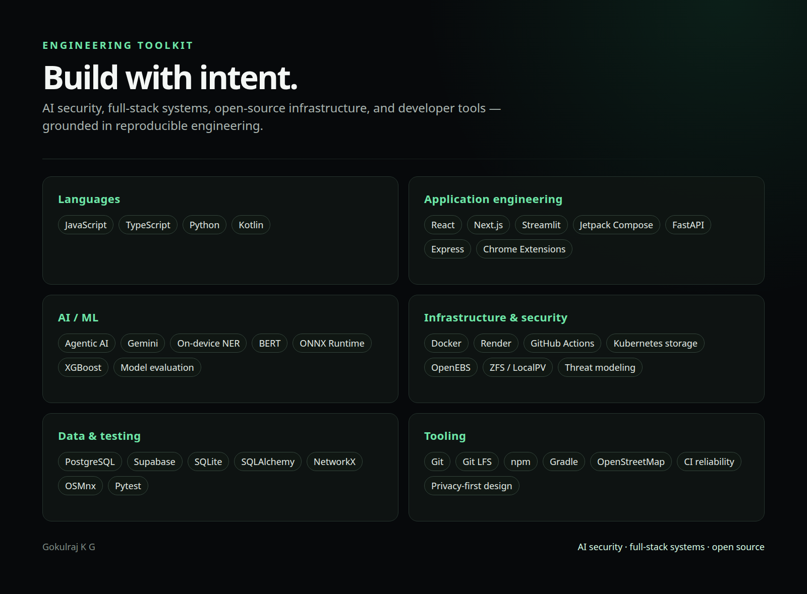

<p align="center">
  
</p>

<p align="center">
  
</p>

<p align="center">
  <a href="https://github.com/gokulrajmisox"></a>
  <a href="https://www.linkedin.com/in/gokulraj-k-g/"></a>
  <a href="https://www.instagram.com/goxzion/"></a>
</p>

<p align="center">
  
</p>

## `whoami`

<table>
<tr>
<td width="56%" valign="top">

```ts
const gokulraj = {
  role: [
    "AI security builder",
    "full-stack engineer in training",
    "open-source contributor",
  ],
  basedIn: "Salem, Tamil Nadu, India",
  education: "BE CSE @ Knowledge Institute of Technology",
  buildsWith: ["JavaScript", "TypeScript", "Python", "Kotlin", "Rust"],
  explores: ["agentic AI", "MCP", "privacy", "systems"],
  principle: "make useful systems safer to use",
};
```

</td>
<td width="44%" valign="top">

### What I build

- **AI security and privacy controls** at the browser and keyboard boundary
- **Search and memory infrastructure** for agents, code, documents, and RAG
- **Forensic finance products** that turn discrepancies into evidence-backed decisions
- **Full-stack systems** with tests, deployment paths, and explicit guardrails

</td>
</tr>
</table>

> **Build the feature. Measure the boundary. Document the limitation.**

## `featured builds`

<table>
<tr>
<td width="50%" valign="top">

### [XERJ — Herdr integration](https://github.com/xerj-org/xerj/pull/2891)

A merged upstream contribution to XERJ, an AI search engine and MCP server for code, docs, logs, JSONL/CSV, and PDFs. The Herdr integration adds a `worktree.created` hook, workspace indexing through `xerj autoindex .`, a plugin manifest, smoke tests, and setup/removal documentation.

`Rust ecosystem` `MCP` `Agent tooling` `Herdr` `Integration tests`

</td>
<td width="50%" valign="top">

### [TESSERACT / LedgerGuard AI](https://github.com/gokulrajmisox/ledgerguard-ai)

An autonomous finance-intelligence and invoice-forensics platform for reconciling invoices, purchase orders, and bank records. It combines document forensics, 3-way reconciliation, evidence classification, human review, and Merkle audit trails.

`Next.js 16` `React 19` `TypeScript` `Three.js` `Framer Motion` `Recharts`

</td>
</tr>
<tr>
<td width="50%" valign="top">

### [GATEKEEP.AI](https://github.com/gokulrajmisox/GATEKEEP.AI)

A browser privacy firewall for safer AI use. It scans prompts locally before submission, detects PII and secrets, and warns or blocks with an explainable reason.

`Manifest V3` `JavaScript` `ONNX Runtime` `Local NER` `Chrome Offscreen Documents`

</td>
<td width="50%" valign="top">

### [SilentWindow](https://github.com/gokulrajmisox/ews)

A research prototype for reducing ICU alarm fatigue through trust-aware signals, patient-specific temporal features, XGBoost, and persistent evidence accumulation. Recent merged work adds a future-window proxy training target and regression coverage.

`Python` `FastAPI` `XGBoost` `Temporal labels` `Pytest`

</td>
</tr>
<tr>
<td width="50%" valign="top">

### [PrivacyFirewall](https://github.com/gokulrajmisox/PrivacyFirewall)

An Android privacy keyboard that combines regex detection with quantized BERT NER to intercept sensitive text before it reaches messaging or AI apps.

`Kotlin` `Jetpack Compose` `InputMethodService` `ONNX Runtime Mobile` `DataStore`

</td>
<td width="50%" valign="top">

### [BOLT McLaren P1 GTR Digital Twin](https://github.com/gokulrajmisox/bolt-mclaren-p1-gtr)

A high-fidelity 3D digital twin and telemetry OS with WebGL rendering, an exploded engineering BOM, simulated ACID storage concepts, procedural audio, and cinematic interaction design.

`React` `Vite` `Three.js` `React Three Fiber` `Framer Motion`

</td>
</tr>
</table>

## `recent contribution signal`

### Merged upstream

- [XERJ #2891](https://github.com/xerj-org/xerj/pull/2891) — added the official Herdr integration with worktree hooks, workspace indexing, plugin registration, smoke tests, and documentation.
- [XERJ #2890](https://github.com/xerj-org/xerj/pull/2890) — completed contributor/CLA registration for the upstream project.
- [wshobson/agents #785](https://github.com/wshobson/agents/pull/785) — fixed fresh-checkout test targets by including the declared development dependencies; validation reported 696 passing tests and 6 passing smoke tests, with external CLI skips documented.
- [ews #2](https://github.com/gokulrajmisox/ews/pull/2) and [ews #3](https://github.com/gokulrajmisox/ews/pull/3) — improved the future-window proxy target and regression coverage for the research pipeline.
- [ledgerguard-ai #1](https://github.com/gokulrajmisox/ledgerguard-ai/pull/1) — delivered the TESSERACT product UX overhaul, 13 static routes, responsive interactions, accessibility work, and a passing TypeScript/build verification.

### Proposal and project work

- [OpenEBS PVC-level ZFS overrides branch](https://github.com/gokulrajmisox/openebs/tree/oep-677-pvc-zfs-overrides) — design/proposal work; not labeled as an upstream-merged PR.
- [GATEKEEP.AI #1](https://github.com/gokulrajmisox/GATEKEEP.AI/pull/1) — closed PR improving debug logging and preventing raw prompt/PII logging.
- [PVZF-Translation #226](https://github.com/Teyliu/PVZF-Translation/pull/226) — closed PR correcting malformed localization JSON.

## `tech stack`

<p align="center">
  
</p>

<p align="center">
  
  
  
  
  
</p>

## `now learning`

- Designing safer agentic workflows and runtime policy boundaries
- Building search, memory, and retrieval systems for AI tools
- Deepening Rust, MCP integrations, Kubernetes storage, and ZFS knowledge
- Improving evaluation loops for AI-assisted systems

## `connect`

<p align="center">
  <a href="https://github.com/gokulrajmisox"></a>
  <a href="https://www.linkedin.com/in/gokulraj-k-g/"></a>
  <a href="https://www.instagram.com/goxzion/"></a>
</p>

<p align="center">
  
</p>
