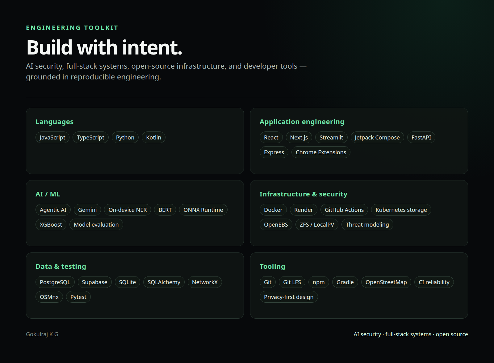

# Gokulraj K G

**AI security · full-stack systems · open source**

I build software that makes intelligent systems safer, more useful, and easier to operate — from browser and mobile privacy controls to AI-assisted developer tools, navigation systems, and storage infrastructure.

[GitHub](https://github.com/gokulrajmisox) · [LinkedIn](https://www.linkedin.com/in/gokulraj-k-g/) · [Creative portfolio](https://www.instagram.com/goxzion/)

  

---

## Current focus

- Building **AI security and privacy controls** that intervene at the point where sensitive data is about to leave a user's device.
- Exploring **agentic AI**, developer tooling, and systems that make AI-assisted workflows more reliable.
- Developing **full-stack products** with thoughtful security boundaries, reproducible tests, and practical deployment paths.
- Contributing to **open-source infrastructure**, including design work around PVC-level ZFS volume-property overrides in OpenEBS.

I am a BE Computer Science and Engineering student at Knowledge Institute of Technology, Tamil Nadu, India, and an aspiring software engineer who prefers learning by shipping and reviewing real systems.

## Featured engineering

### [GATEKEEP.AI](https://github.com/gokulrajmisox/GATEKEEP.AI)

A browser-level privacy firewall for safer AI use. GATEKEEP.AI scans text locally at the browser interaction boundary before a prompt is submitted to supported AI websites, then explains, warns, or blocks when it detects sensitive content.

The project combines a Chrome Manifest V3 extension, JavaScript ES modules, pattern-based PII and secret detection, optional on-device named-entity recognition with `@huggingface/transformers`, ONNX Runtime Web/WASM, Chrome Offscreen Documents, Shadow DOM UI isolation, and an esbuild-based build path. It deliberately has no project backend or telemetry service.

**Engineering depth:** the repository includes a threat model, evaluation notes, deterministic regression tests, benchmark scripts, CI, daily health checks, and a documented distinction between local prompt scanning and first-use model-asset downloads. It is a strong example of security-minded product engineering without overstating the guarantee: it reduces accidental disclosure but is not a complete enterprise DLP system.

### [PrivacyFirewall](https://github.com/gokulrajmisox/PrivacyFirewall)

An Android privacy keyboard and on-device DLP prototype that intercepts sensitive text before it reaches messaging or AI applications. The system combines deterministic regex detection for structured secrets and PII with a quantized BERT NER model executed locally through ONNX Runtime Mobile.

The implementation uses Kotlin, Jetpack Compose, `InputMethodService`, a pure-Kotlin WordPiece tokenizer, BIO entity parsing, Android DataStore preferences, and an approximately 106 MB model asset managed through Git LFS. Users can review findings and redact or override them through the keyboard-layer workflow.

**Engineering depth:** the interesting design decision is the interception boundary. A keyboard can protect multiple target apps without requiring an integration in each application, while the repository documents the limits of the approach and the need to verify offline behavior on the target device.

### [CampusAI / SmartCampus](https://github.com/gokulrajmisox/smartcampus)

An inclusive campus-navigation copilot that combines natural-language assistance with graph-based route planning. Users can ask for directions, find facilities, view routes on an interactive map, and request accessibility-aware navigation.

The stack includes Python, Streamlit, Google Gemini through the Google GenAI SDK, OpenStreetMap data, OSMnx, NetworkX, Folium, Streamlit-Folium, Docker, Render, and Pytest. Route planning is implemented with BFS, DFS, uniform-cost search, and A* variants, with local routing behavior retained when Gemini is unavailable.

**Engineering depth:** this is more than a chat wrapper. The repository contains a route graph, role-aware assistance, accessibility metadata, map layers, deployment configuration, health checks, tests, and a judge-facing demonstration path.

### [SilentWindow](https://github.com/gokulrajmisox/ews)

A retrospective ICU early-warning research prototype focused on reducing alarm fatigue through trust-aware signal processing and persistent evidence. Its pipeline assesses signal credibility, builds patient-specific temporal features, applies an XGBoost model, and accumulates evidence through a `STABLE → WATCH → ALERT` state machine.

The repository combines Python, FastAPI, XGBoost, a static dashboard, Docker, Render deployment, CI, calibration, replay evaluation, and documented research experiments. It is explicitly a research prototype, not a medical device or clinically validated decision system.

**Engineering depth:** the project is notable for making its limitations visible. It documents proxy lead-time assumptions, held-out retrospective results, process-local state, missing production controls, and the difference between validation metrics and chronological replay metrics.

### [Library Book Management System](https://github.com/gokulrajmisox/library-management-system)

A BE CSE data-structures capstone that pairs a Next.js/TypeScript/Tailwind frontend with a Python FastAPI backend. Its core library operations are backed by hand-written data-structure engines rather than framework-only CRUD.

The implementation includes a hash table with separate chaining, binary-search-tree title indexing, an undo stack, a FIFO waiting-list queue, an adjacency-list recommendation graph with BFS, linked-list activity logging, sorting visualizations, circulation workflows, CSV analytics, SQLAlchemy models, Docker Compose, and automated backend tests.

## Open-source work

### Proposal / design work

- **OpenEBS — PVC-level ZFS volume-property overrides:** maintained a public fork and the branch [`oep-677-pvc-zfs-overrides`](https://github.com/gokulrajmisox/openebs/tree/oep-677-pvc-zfs-overrides). The branch includes the OEP commit [“docs: add OEP for PVC-level ZFS overrides”](https://github.com/gokulrajmisox/openebs/commit/77dbecc23c0c7a1b8ae788679d261706558b6257). This is presented as a proposal/design branch; I am not labeling it as an upstream-merged pull request because a corresponding upstream PR was not publicly verifiable during review.

### Pull requests

- [wshobson/agents #785](https://github.com/wshobson/agents/pull/785) — **open**: include development dependencies in test targets.
- [gokulrajmisox/GATEKEEP.AI #1](https://github.com/gokulrajmisox/GATEKEEP.AI/pull/1) — **closed**: gate the logger behind a debug flag and stop logging raw prompts/PII.
- [gokulrajmisox/ews #1](https://github.com/gokulrajmisox/ews/pull/1) — **open**: pin a Python-3.10-compatible scikit-learn version to fix CI.
- [Teyliu/PVZF-Translation #226](https://github.com/Teyliu/PVZF-Translation/pull/226) — **closed**: correct malformed localization JSON.

Statuses above are intentionally shown as GitHub reports them. Closed is not treated as merged, and proposal work is not treated as production code.

## Recognition

- **GATEKEEP.AI:** reported by the project team as selected among 25 teams for a grand-final round. I am keeping the wording conservative because an official public event-results URL was not available during verification; add that source link before publishing if you want this recognition featured prominently.

## Technical toolkit

**Languages**  
JavaScript · TypeScript · Python · Kotlin

**Frontend and application engineering**  
React · Next.js · Streamlit · Jetpack Compose · Tailwind CSS · FastAPI · Express · Chrome Extensions · Android `InputMethodService`

**AI / ML**  
Agentic AI workflows · Gemini integration · on-device NER · BERT tokenization · ONNX Runtime · XGBoost · model evaluation · calibration · privacy-preserving inference boundaries

**Infrastructure and systems**  
Docker · Render · GitHub Actions · Kubernetes storage concepts · OpenEBS · ZFS / LocalPV design work · CI reliability · threat modeling

**Data and developer tools**  
PostgreSQL / Supabase · SQLite · SQLAlchemy · NetworkX · OSMnx · OpenStreetMap · Pytest · npm · Gradle · Git LFS · GitHub

## Selected repositories

- [GATEKEEP.AI](https://github.com/gokulrajmisox/GATEKEEP.AI) — browser privacy firewall for AI interactions
- [PrivacyFirewall](https://github.com/gokulrajmisox/PrivacyFirewall) — Android keyboard-layer privacy protection
- [CampusAI / SmartCampus](https://github.com/gokulrajmisox/smartcampus) — AI-assisted accessible campus navigation
- [SilentWindow](https://github.com/gokulrajmisox/ews) — trust-aware ICU early-warning research prototype
- [Library Book Management System](https://github.com/gokulrajmisox/library-management-system) — data-structures-driven full-stack capstone

## Connect

If you are working on AI security, developer tools, open-source infrastructure, or practical full-stack systems, I would be glad to connect.

- [GitHub](https://github.com/gokulrajmisox)
- [LinkedIn](https://www.linkedin.com/in/gokulraj-k-g/)
- [Creative portfolio / Instagram](https://www.instagram.com/goxzion/)
